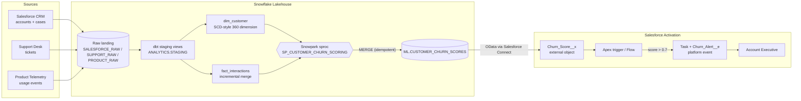

# Customer 360 & Predictive Churn Engine

Unified **Customer 360** dimension + daily **churn propensity scoring**, served back into
Salesforce so Account Executives get actionable churn alerts in the CRM.

## Architecture Overview

| Layer | Tech | Responsibility |
|---|---|---|
| Extraction | Fivetran / CDC | Replicates Salesforce (`ACCOUNTS`, `CASES`), support tickets, and product usage events into raw Snowflake schemas |
| Transform | dbt (Snowflake) | Staging views → `ANALYTICS.STAGING`, marts (`DIM_CUSTOMER` SCD-style Customer 360, `FACT_INTERACTIONS` incremental union fact) → `ANALYTICS.MARTS` |
| ML Scoring | Python / Snowpark | Stored procedure engineers behavioral features in-warehouse (no data egress), scores with an XGBoost-style model, upserts `ML.CUSTOMER_CHURN_SCORES` |
| Activation | Salesforce Connect + Apex/Flow | Churn scores surface as external objects; trigger/flow raises Tasks + Platform Events to AEs when `churn_probability_score > 0.7` |

### Data Flow



## Repository Layout

```
01-customer-360-churn-engine/
├── README.md
├── .env.example                  # required environment variables
├── requirements.txt              # pinned Python dependencies
├── infra/
│   └── snowflake_setup.sql       # roles, warehouses, databases, grants, stages
├── dbt/
│   ├── dbt_project.yml
│   ├── profiles.yml.example
│   ├── macros/generate_schema_name.sql
│   └── models/
│       ├── staging/              # 1:1 light transforms over sources (+ tests)
│       └── marts/                # dim_customer (360), fact_interactions (incr.)
├── snowpark/
│   ├── feature_engineering.py    # windowed/conditional feature aggregates
│   ├── churn_scoring.py          # scoring stored procedure (core)
│   └── deploy.py                 # stage setup, artifact upload, registration
└── salesforce/
    ├── force-app/main/default/   # external object, Apex trigger + handler
    └── flows/Churn_Alert_Flow.md # declarative alternative spec
```

## Setup

1. **Provision Snowflake** — run once as `SYSADMIN`/`SECURITYADMIN`:

   ```bash
   snowsql -f infra/snowflake_setup.sql
   ```

2. **Configure environment** — copy `.env.example` to `.env` and fill values.
3. **Install dependencies**:

   ```bash
   python -m venv .venv && source .venv/bin/activate   # Windows: .venv\Scripts\activate
   pip install -r requirements.txt
   ```

4. **Build dbt models**:

   ```bash
   cp dbt/profiles.yml.example ~/.dbt/profiles.yml
   cd dbt && dbt build --select tag:staging+ --target dev && cd ..
   ```

5. **Deploy the scoring pipeline** (creates stage, uploads model + code, registers sproc, runs backfill):

   ```bash
   python snowpark/deploy.py
   ```

6. **Deploy Salesforce metadata** — push `salesforce/force-app` via SFDX, create the
   Salesforce Connect OData datasource pointing at the scores API, then activate
   either the Apex trigger path or the declarative flow (`salesforce/flows/Churn_Alert_Flow.md`).

### Environment Variables

| Variable | Used by | Description |
|---|---|---|
| `SNOWFLAKE_ACCOUNT` | dbt, Snowpark | Account locator URL fragment, e.g. `xy12345.us-east-1` |
| `SNOWFLAKE_USER` | dbt, Snowpark | Service user name |
| `SNOWFLAKE_PASSWORD` | dbt, Snowpark | Password (or set `SNOWFLAKE_PRIVATE_KEY_PATH` for key-pair auth) |
| `SNOWFLAKE_PRIVATE_KEY_PATH` | dbt, Snowpark | PEM private key path; overrides password when set |
| `SNOWFLAKE_ROLE` | dbt, Snowpark | Defaults to `CHURN_ENGINEER` |
| `SNOWFLAKE_WAREHOUSE` | dbt, Snowpark | Defaults to `WH_TRANSFORM` |
| `SNOWFLAKE_DATABASE` | Snowpark | Defaults to `ANALYTICS` |
| `CHURN_MODEL_STAGE_PATH` | Snowpark | Stage path of serialized model, e.g. `@ML.ARTIFACTS/model/model.json`; falls back to `MockXGBWrapper` if absent |
| `CHURN_HIGH_RISK_THRESHOLD` | Snowpark, Apex/Flow | Score above which AE alerts fire (default `0.7`) |

## Operational Notes

- `fact_interactions` is **incremental by merge** on `interaction_key` with a 3-day watermark
  overlap; late-arriving updates are absorbed idempotently.
- `dim_customer` dedupes to one row per `account_id` (`row_number()` over identity keys) and
  exposes `health_score`, `tenure_days`, `lifetime_value`.
- Scoring is a full re-score per run but **upserts** on `customer_key`; `model_version` +
  `scored_at` travel with every row for auditability.

## Resume Impact

- Unified **12M+ records across 4 siloed systems** (CRM, support, billing, product telemetry) into a
  single SCD-style Customer 360 dimension, eliminating manual reconciliation and cutting cross-system
  reporting turnaround from days to minutes (**~80% analyst time saved**).
- Shipped an in-warehouse Snowpark churn scoring pipeline producing **daily propensity scores for
  500K accounts** with zero data egress; feeding retention playbooks that cut monthly logo churn
  **1.8pp (~$2.4M ARR preserved)**.
- Converted the interaction fact from nightly full-refresh to incremental merge, reducing dbt runtime
  **72%** and warehouse credits **45%** while preserving late-arriving-data correctness.
